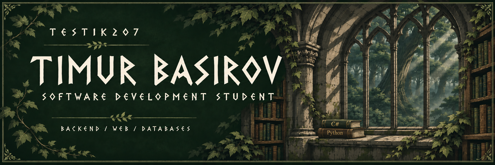

<!-- Profile README for Testik207. Keep the assets folder alongside this file. -->

  

  <a href="#about-me">ABOUT</a> &nbsp; / &nbsp;
  <a href="#toolbox">TOOLBOX</a>

<h2>About me</h2>

Hi, I'm <strong>Timur</strong>, a final-year software development student at <strong>Techno TLN</strong>. I enjoy working with databases and backend logic, and understanding how interfaces, code and data fit together.

I learn through coursework and individual and team projects - from React websites to C# applications. My longer-term goal is to understand software more deeply, including how it interacts with hardware.

<table>
  <tr>
    <td width="50%" valign="top">
      <strong>Currently exploring</strong> 
      Backend development, SQL and database design.
    </td>
    <td width="50%" valign="top">
      <strong>How I learn</strong> 
      Build something, understand how it works, improve it.
    </td>
  </tr>
</table>

<h2>Toolbox</h2>

Technologies I have used in coursework and projects.

<table>
  <tr>
    <td width="50%" valign="top"><strong>Backend &amp; data</strong> C# · ASP.NET Core · Entity Framework Core SQL · SQLite · PHP</td>
    <td width="50%" valign="top"><strong>Web interfaces</strong> HTML · CSS · JavaScript React · Vite · Mantine</td>
  </tr>
  <tr>
    <td valign="top"><strong>Application development</strong> .NET MAUI · XAML</td>
    <td valign="top"><strong>Also worked with</strong> Python · Luau · WordPress</td>
  </tr>
</table>

